# Unstrapped

**Your strap, your data, your Mac.** Unstrapped is a local-first macOS app that syncs a WHOOP 4.0 or 5.0
strap directly over Bluetooth, keeps everything in a SQLite database on your Mac, and computes sleep,
recovery, strain and stress on-device. No account, no cloud and no phone needed.

[](https://github.com/billymcdowell/unstrapped/actions/workflows/ci.yml)
[](LICENSE)

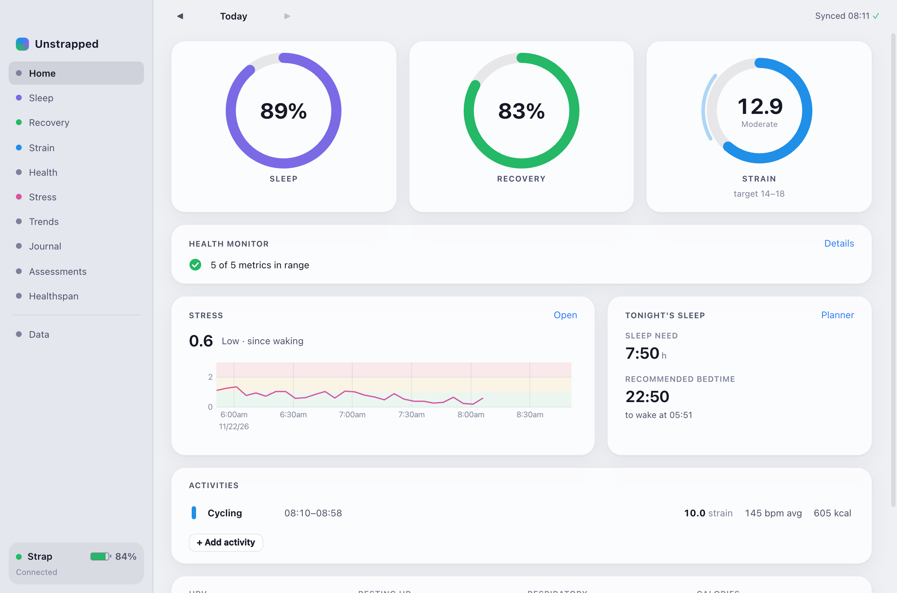

> [!WARNING]
> **Experimental.** The Bluetooth protocol code is built from public reverse-engineering notes. It is
> tested against a protocol-exact emulator, but **it has not been tested on a physical strap yet**.
> See [Before you connect a real strap](#before-you-connect-a-real-strap).

> Unstrapped is an independent project. It is **not affiliated with, endorsed by or sponsored by
> WHOOP, Inc.** "WHOOP" is a trademark of WHOOP, Inc. and is used here only to name the hardware this
> app talks to. Nothing in this app is medical advice.

---

## Contents

- [Features](#features)
- [Screenshots](#screenshots)
- [Install](#install)
- [Build from source](#build-from-source)
- [Try it without a strap (emulator)](#try-it-without-a-strap-emulator)
- [Before you connect a real strap](#before-you-connect-a-real-strap)
- [Where your data lives](#where-your-data-lives)
- [Tests](#tests)
- [Project layout](#project-layout)
- [Releasing](#releasing)
- [Contributing](#contributing)
- [Acknowledgements](#acknowledgements)
- [License](#license)

## Features

- **Direct Bluetooth sync.** Downloads the strap's stored history (up to about 14 days) whenever you
  sync, then works fully offline.
- **On-device scores.** Sleep performance and stages, recovery (HRV, resting heart rate, respiratory
  rate), day strain with heart-rate zones, and stress, all computed from raw samples on your Mac.
- **Health monitor.** Tracks nightly metrics against your own baseline and flags readings outside it.
- **Trends.** Any metric over 1 week, 1 month, 6 months or 1 year, with averages and best and worst days.
- **Journal and insights.** Log daily behaviours and see how they relate to your recovery.
- **Weekly and monthly assessments**, plus a healthspan / VO2 max estimate.
- **Your data stays yours.** Raw frames are archived verbatim, decoded data can be rebuilt at any
  time, and the Data screen exports CSV.
- **Menu bar app.** Closing the window keeps it running in the menu bar. It can launch at login,
  sync automatically and remind you when a sync is overdue.
- **Liquid Glass window** on macOS 26 (Tahoe) or later, with a frosted fallback on older versions.
  Follows the system light or dark appearance.
- **Built-in strap emulator** for developing and demoing without hardware.

## Screenshots

All screenshots use synthetic test data.

| Sleep | Recovery |
|---|---|
| 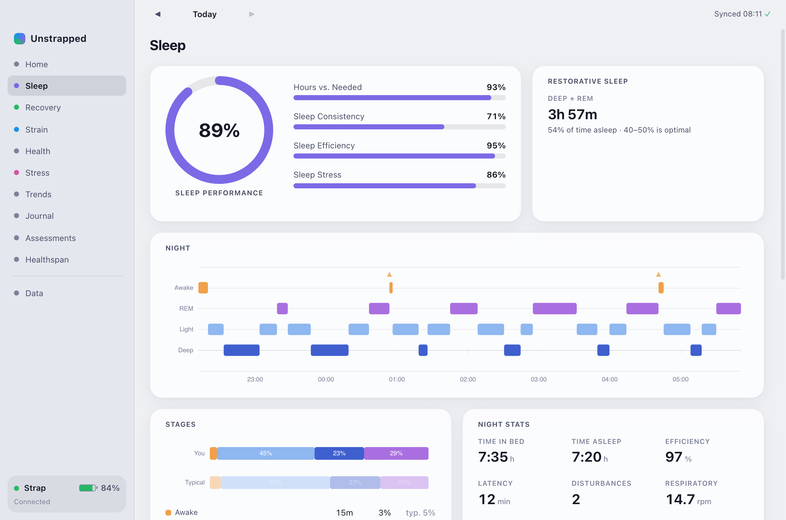 | 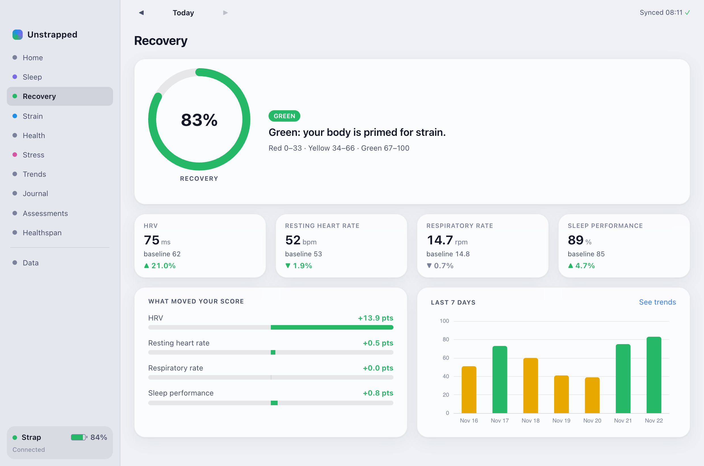 |

| Strain | Stress |
|---|---|
| 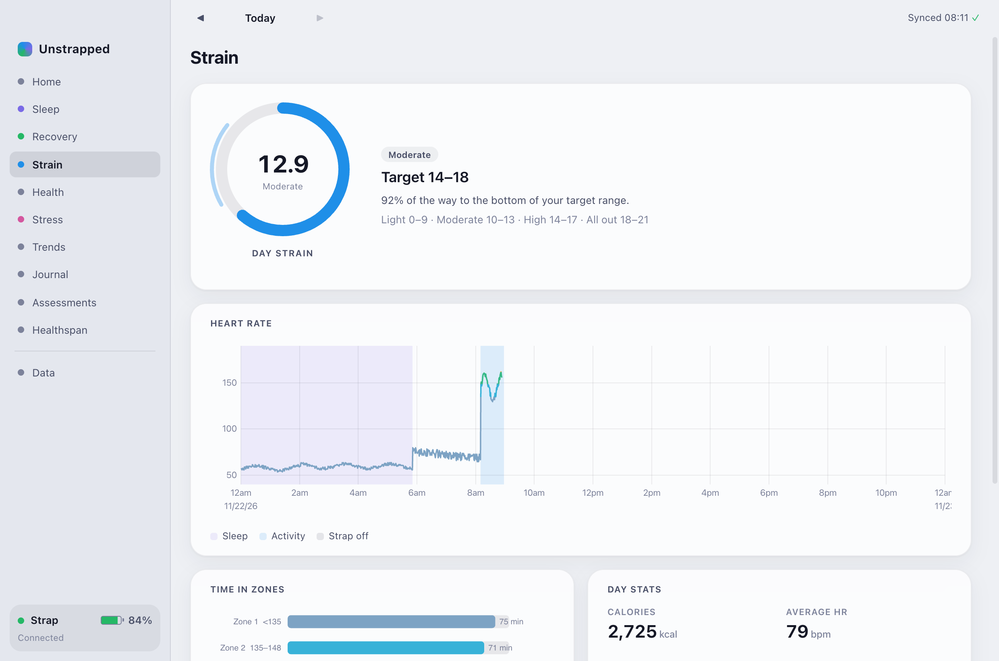 | 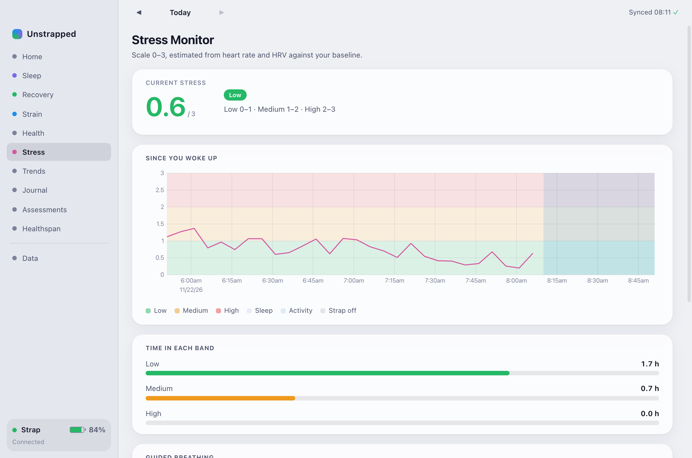 |

| Health monitor | Trends |
|---|---|
| 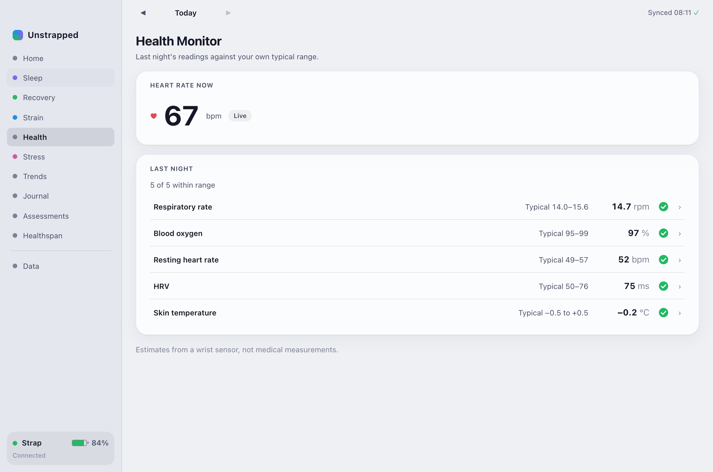 | 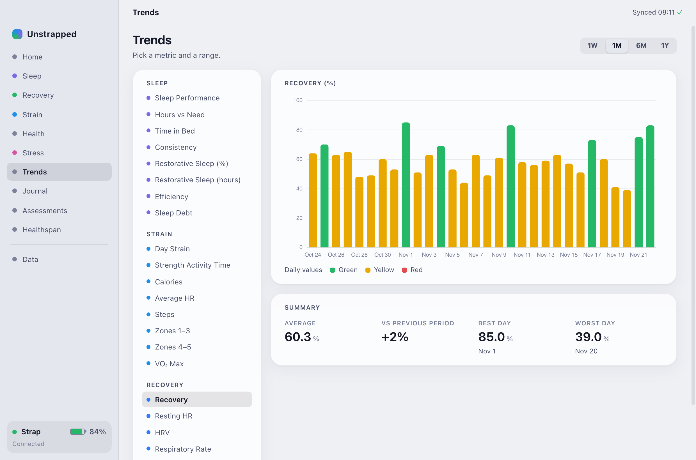 |

| Journal | Assessments |
|---|---|
| 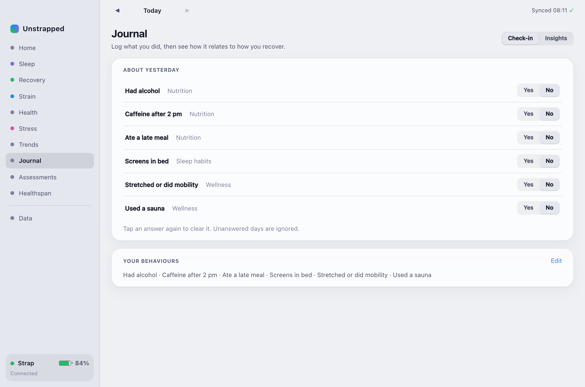 | 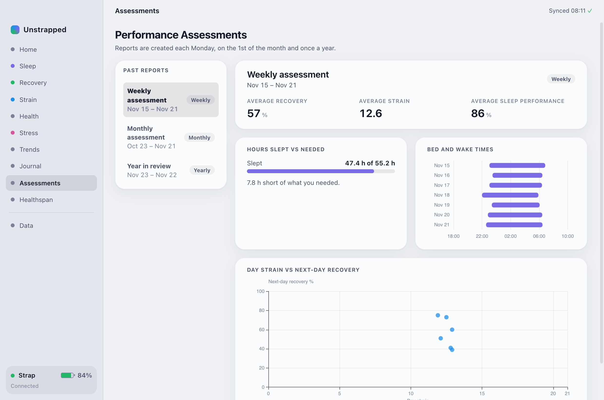 |

| Healthspan | Data and export |
|---|---|
| 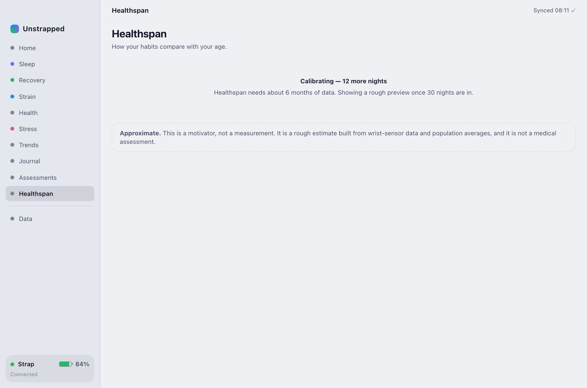 | 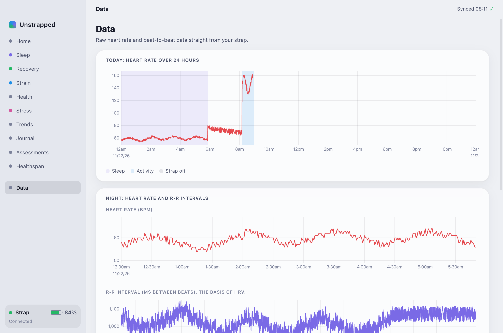 |

| Strap connection | Dark mode |
|---|---|
| 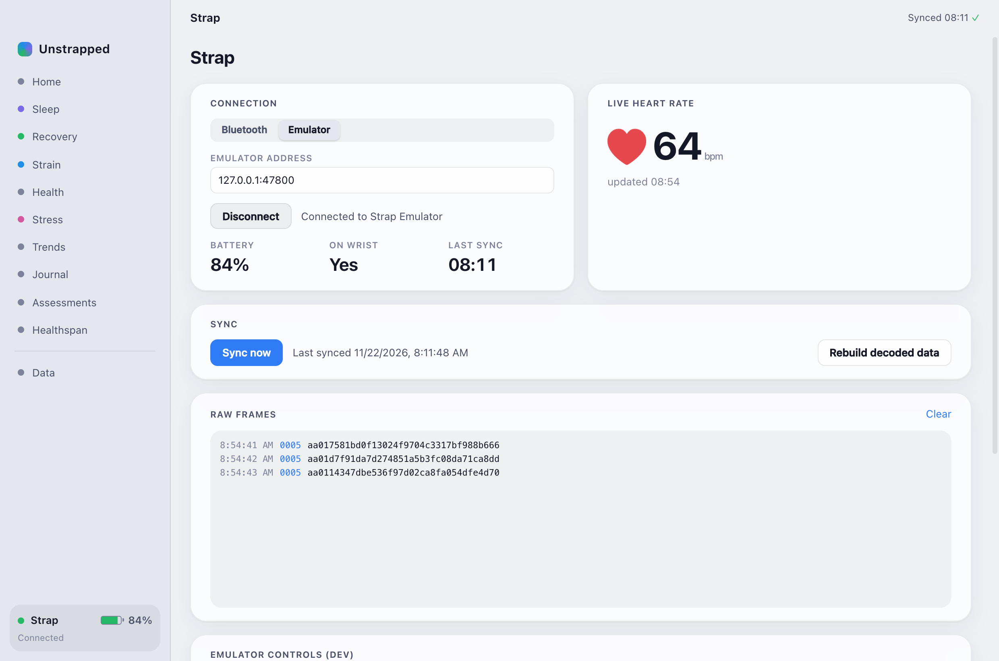 | 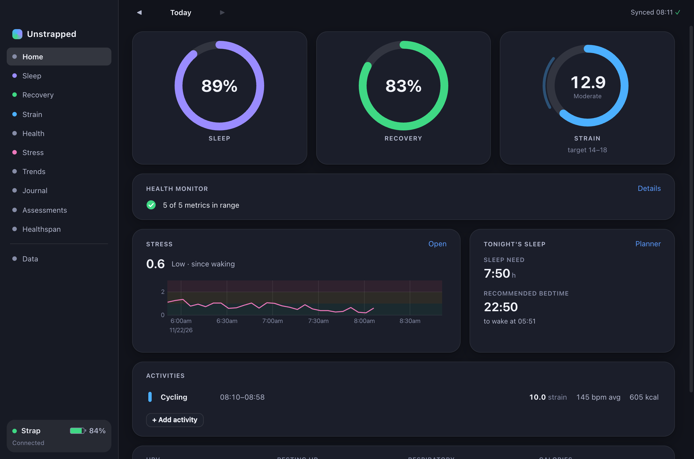 |

## Install

**Requirements:** a Mac with Bluetooth LE, Apple Silicon or Intel. Developed and tested on macOS 26
(Tahoe). Older versions should work, with a frosted window instead of Liquid Glass.

1. Download the latest `.dmg` from the [Releases page](https://github.com/billymcdowell/unstrapped/releases).
2. Open it and drag **Unstrapped** into **Applications**.
3. The release builds are not signed with an Apple Developer ID, so macOS blocks the first launch.
   Either right-click **Unstrapped.app**, choose **Open** and confirm, or run:

   ```bash
   xattr -cr /Applications/Unstrapped.app
   ```

4. Allow Bluetooth access when macOS asks. Unstrapped needs it to talk to the strap.

## Build from source

### Prerequisites

| Tool | Version | Install |
|---|---|---|
| Xcode Command Line Tools | any recent | `xcode-select --install` |
| Rust | stable, 1.88 or later (edition 2024) | [rustup.rs](https://rustup.rs) |
| Node.js | 20.19+ or 22.12+ | [nodejs.org](https://nodejs.org) or `brew install node` |

### Run in development

```bash
git clone https://github.com/billymcdowell/unstrapped.git
```

```bash
cd unstrapped
```

```bash
npm install
```

```bash
npm run tauri dev
```

The first build compiles the Rust workspace and takes a few minutes. After that, the UI reloads
on save, and Rust changes trigger a rebuild.

### Build the app bundle

```bash
npm run tauri build
```

The `.app` and `.dmg` land in `target/release/bundle/macos/` and `target/release/bundle/dmg/`. For a
faster debug build use `npm run tauri build -- --debug` (output under `target/debug/bundle/`).

### UI only, in a browser

```bash
npm run dev
```

Then open <http://localhost:1420>. Outside the Tauri window, the UI runs against a deterministic
mock backend (`src/api/mock.ts`) with about 45 days of synthetic data. This is the quickest way to
work on screens, and it is how the screenshots above were made.

## Try it without a strap (emulator)

`unstrapped-emulator` is a stand-in strap. It speaks the same byte-level protocol as the real
hardware over a local TCP socket, and it generates 14 days of reproducible synthetic physiology
(sleep, workouts, heart rate, HRV, skin temperature).

1. In one terminal, start the emulated strap:

   ```bash
   cargo run -p unstrapped-emulator -- --family whoop4 --fast-history
   ```

2. In a second terminal, start the app:

   ```bash
   npm run tauri dev
   ```

3. In the app, open **Strap** (bottom of the sidebar), choose **Emulator**, click **Connect**, then
   **Sync now**. Scores appear once the download finishes. Recovery needs a few nights of baseline.

Useful variations:

- **WHOOP 5.0:** restart the emulator with `--family whoop5`, then Disconnect and Connect in the app.
- **Watch data arrive quickly:** add `--time-scale 60`, so one emulated minute passes per real second.
- **Simulate real-world events** from the Strap screen's dev controls, or from a shell:

  ```bash
  cargo run -p unstrapped-emulator -- ctl take_off
  ```

  Other actions: `put_on`, `out_of_range`, `in_range`, `advance_minutes 600`, `set_battery 15`,
  `charge_on`, `charge_off`.

All flags are listed in [docs/EMULATOR.md](docs/EMULATOR.md).

## Before you connect a real strap

Please read this first. The protocol work is careful, but it has only been checked against
published captures and the emulator.

- **Use one app at a time.** After the Mac confirms a chunk of history, the strap may free that
  storage. If the official app syncs first, Unstrapped may not see that data, and the reverse is
  true too.
- **Keep your phone out of Bluetooth range** the first time you connect, so the strap pairs with the Mac.
- **Back up your data folder** (see below) before trying new builds.
- If anything looks wrong, open an issue with the raw frames from the Strap screen's **Raw frames**
  panel. They are readings from your own body and device, so review them before posting publicly.

## Where your data lives

Everything is stored locally in one SQLite file:

```text
~/Library/Application Support/com.williammcdowell.unstrapped/strap.sqlite3
```

Raw frames from the strap are kept verbatim, so decoded data can be rebuilt with **Strap → Rebuild
decoded data** after a decoder fix. To start from scratch, quit the app and delete that folder.
Nothing is sent over the network.

## Tests

```bash
cargo test --workspace
```

This runs the unit, emulator and app tests: CRCs, frame validation, every packet kind round-tripped,
fragmentation and reassembly, history sync, the metrics engine and the screen builders.

```bash
cargo test -p unstrapped --test e2e_emulator --release -- --ignored --nocapture
```

This is a full end-to-end sync over TCP for WHOOP 4 and 5 that prints a 7-day table of computed
scores. It takes several minutes.

```bash
npm run build
```

This type-checks and builds the UI.

## Project layout

| Path | What's there |
|---|---|
| `crates/unstrapped-core` | Pure Rust, no I/O: the strap protocol (frames, CRCs, commands, history offload) and the metrics engine (sleep, HRV, recovery, strain, stress) |
| `crates/unstrapped-emulator` | Stand-in strap: TCP service, synthetic physiology, client, `ctl` commands |
| `src-tauri/src` | App backend: `transport` (Bluetooth / emulator), `strap` (connection manager), `sync` (history offload), `db` (SQLite), `compute`, `screens` and `reports` (scores to UI shapes), `commands` (Tauri API), `background` (menu bar, auto sync) |
| `src-tauri/tests` | Headless end-to-end tests through the real emulator path |
| `src` | React UI: `screens`, `components`, `api` (typed client, types, mock backend) |
| `docs` | [PROTOCOL_NOTES.md](docs/PROTOCOL_NOTES.md), [EMULATOR.md](docs/EMULATOR.md), [API_CONTRACT.md](docs/API_CONTRACT.md), and the original build plan [PLAN.md](docs/PLAN.md) |

Stack: [Tauri 2](https://tauri.app), Rust, React 19, TypeScript, Vite, ECharts, SQLite (rusqlite),
[btleplug](https://github.com/deviceplug/btleplug) for Bluetooth LE.

## Releasing

Releases are built by GitHub Actions ([`.github/workflows/release.yml`](.github/workflows/release.yml)).

1. Bump the version in `src-tauri/tauri.conf.json`, `package.json` and the root `Cargo.toml`
   (`[workspace.package]`).
2. Commit, then tag and push:

   ```bash
   git tag v0.2.0
   ```

   ```bash
   git push origin v0.2.0
   ```

3. The workflow runs the tests, builds a universal (Apple Silicon + Intel) `.app` and `.dmg`, and
   attaches them to a **draft** release. Review it on GitHub, then publish it.

Signing and notarization are optional. Add the `APPLE_*` repository secrets listed at the top of
`release.yml` and the workflow signs and notarizes automatically.

## Contributing

Issues and pull requests are welcome. Before opening a PR, please run:

```bash
cargo test --workspace && npm run build
```

Protocol changes should come with a test in `crates/unstrapped-core/src/protocol/tests.rs`, and
the relevant notes in `docs/PROTOCOL_NOTES.md` should be updated. Please don't add code, captures
or fixtures copied from projects whose licenses aren't compatible with MIT.

## Acknowledgements

The protocol facts this app relies on (Bluetooth service and characteristic IDs, frame layouts, CRC
parameters, command numbers) come from the reverse-engineering documentation published by the
[NOOP project](https://github.com/ryanbr/noop). NOOP's license states that these facts are free to
reuse. Unstrapped's code is written independently and includes none of NOOP's code or fixture files.

## License

[MIT](LICENSE) © 2026 Billy McDowell
